# AnfitrIA

[](https://github.com/daaniidam/anfitria/actions/workflows/ci.yml)

Un conserje con IA para pisos turísticos. Los huéspedes preguntan por WhatsApp
—el wifi, a qué hora es el check-in, cómo llegar…— y la IA les contesta con la
información de cada piso. Lo importante: solo responde cuando de verdad tiene la
info; si no la tiene, avisa al huésped y le pasa la pregunta al anfitrión en vez
de inventarse una respuesta.

Lo hice como proyecto de portfolio al terminar el grado de DAM. Quería construir
algo más real que un CRUD de prácticas y, de paso, aprender a hacer un RAG en
condiciones (que la IA conteste basándose en unos datos concretos, no "de
memoria").

Es una demo completa y funcional, **no un producto en producción**. Arranca sin
claves ni coste y con datos de ejemplo. Lo que faltaría para usarlo de verdad lo
cuento al final, sin adornos.

Hay una página que lo resume (problema, solución y decisiones técnicas) en
[`docs/case-study/`](docs/case-study/index.html).

## Lo que más me interesaba: que no se invente cosas

El reto de verdad no era que la IA contestara, sino que **supiera cuándo no
sabe**. Así lo resolví:

- Cada respuesta se ancla en la ficha del piso (busca los fragmentos que más se
  parecen a la pregunta). Guardo las "citas" que usó y un % de confianza, así se
  puede ver en qué se apoyó. No es una caja negra.
- Si no encuentra nada que encaje, **escala**: el huésped recibe un "déjame
  confirmarlo" y la pregunta le llega al anfitrión.
- Cuando el anfitrión contesta, esa respuesta se guarda en la ficha. La próxima
  vez que pregunten lo mismo, la IA ya responde sola.

Y no me fié de "parece que va mejor": me monté un pequeño sistema de evaluación
(`eval/`) con preguntas parafraseadas. Pasar de buscar por palabras a buscar por
significado subió la recuperación del 30 % al 70 %. El umbral está puesto del
lado seguro: ante la duda, prefiere escalar a arriesgar una respuesta mal. El
detalle del pipeline y las decisiones están en [`docs/RAG.md`](docs/RAG.md).

## La interfaz

El panel (React + TypeScript + Tailwind) está pensado como un puesto de trabajo,
no como un menú de opciones: **Hoy · Conversaciones · Alojamientos · Ajustes**.
Funciona también en móvil, con avisos y confirmación antes de borrar.

Hoy, el resumen del día: llegadas, salidas, lo que está pendiente y las
conversaciones en vivo.

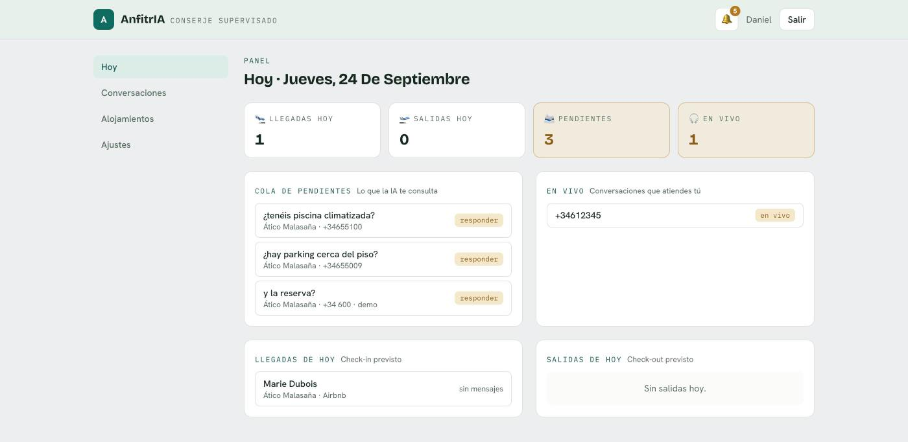

El asistente para conectar un número de WhatsApp Business, en cuatro pasos.

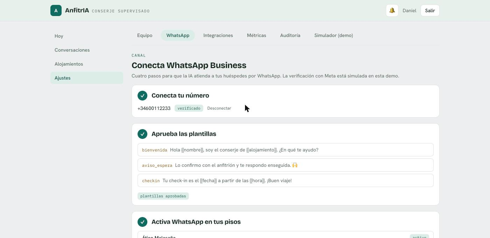

Integraciones con PMS / Channel Manager: en vez de meter la cartera a mano, se
conecta y se sincroniza (y no se duplica al volver a sincronizar). El adaptador
`demo` funciona; los reales se enchufan con sus credenciales.

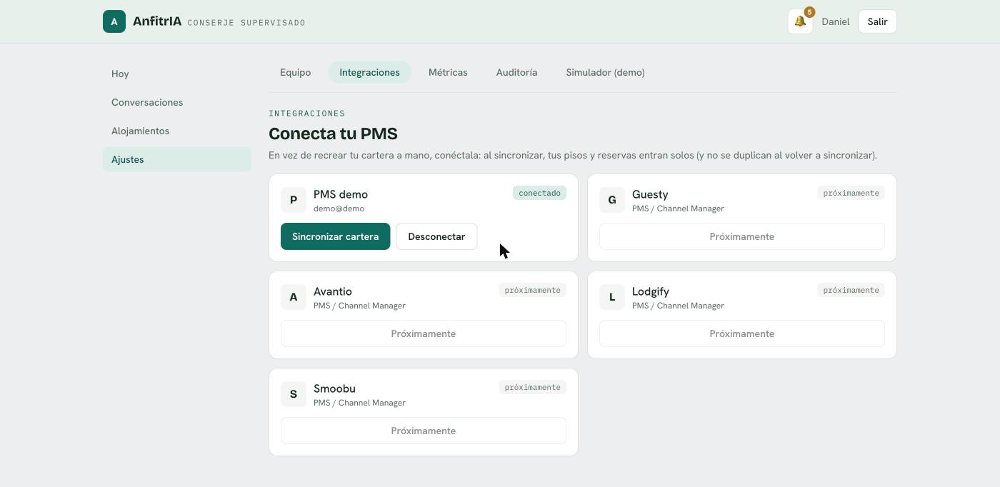

Un checklist de primeros pasos para que un anfitrión nuevo no se quede ante un
panel vacío.

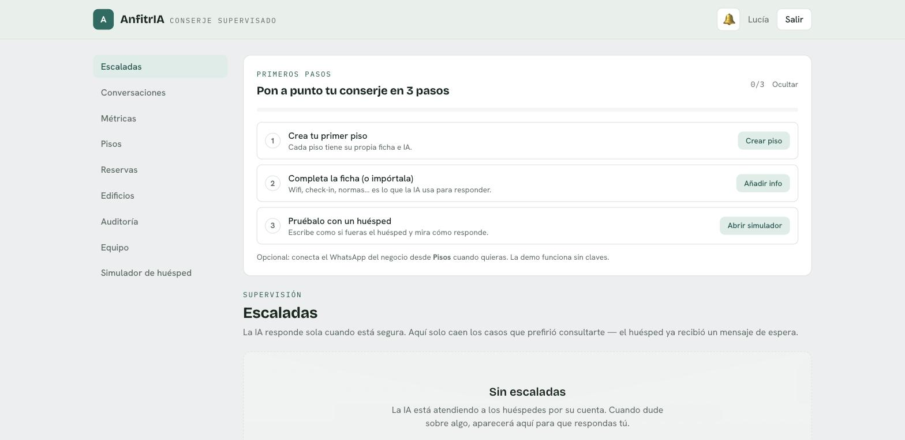

El simulador de huésped: escribes como si fueras el huésped y ves la respuesta al
instante (o el aviso de espera si la IA escala).

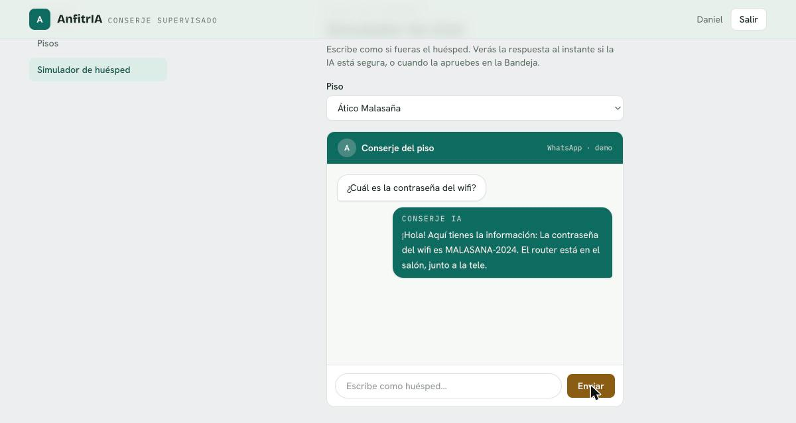

La Bandeja reúne todas las conversaciones. Al abrir una ves el hilo, la respuesta
que sugiere la IA con su medidor de confianza, por qué escaló, y puedes tomar el
control para atender tú en vivo.

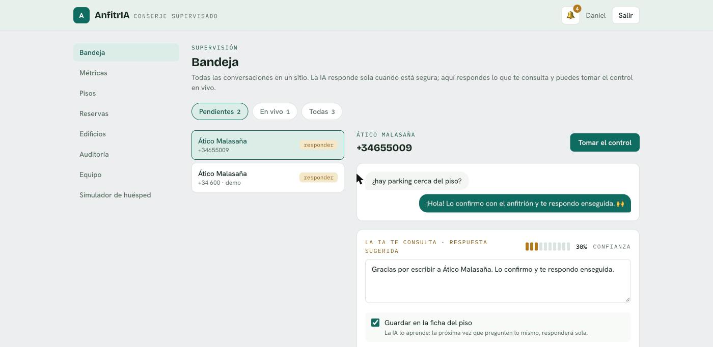

Métricas: cuánto resuelve la IA sola, cuántas escala y el tiempo que ahorra.

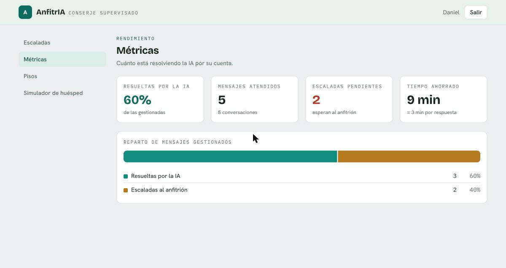

Cuando el anfitrión responde una escalada, puede marcar "guardar en la ficha" y
la IA lo aprende para la próxima.

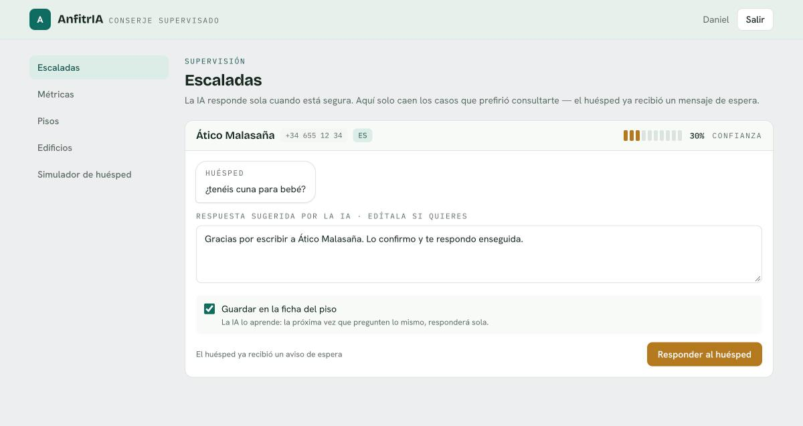

Los edificios agrupan pisos y comparten lo común (cómo llegar, portal, parking…)
entre todos a la vez.

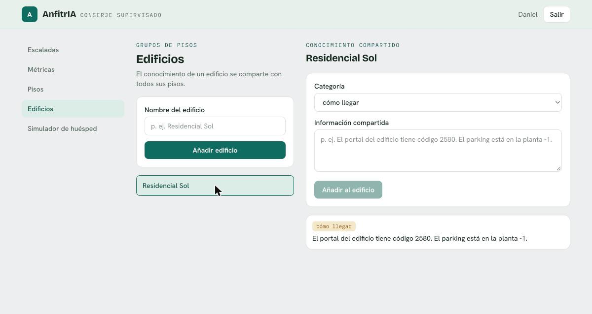

También hay atención en vivo (el anfitrión toma el control y la IA se aparta),
equipo con roles (propietario y miembros, datos aislados por organización):

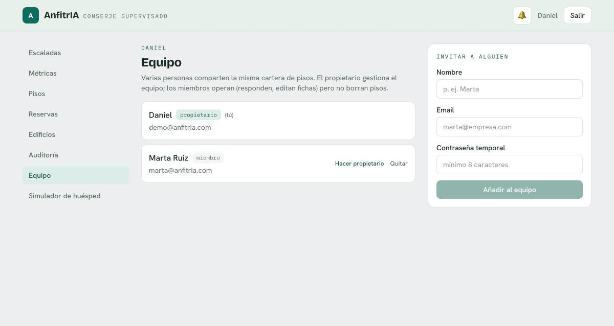

Reservas con su origen (Booking · Airbnb · directa) y la fase de la estancia, de
modo que la IA puede dar fechas concretas ("tu check-in es mañana a las 15:00").
Se conecta con Booking/Airbnb importando el calendario iCal. Multi-idioma
(ES/EN/FR/DE/IT).

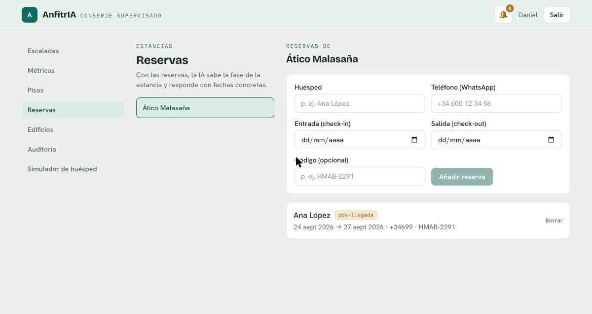

Para no teclear la ficha a mano, se puede importar desde un CSV o el PDF del
manual del piso, que se trocea e indexa solo.

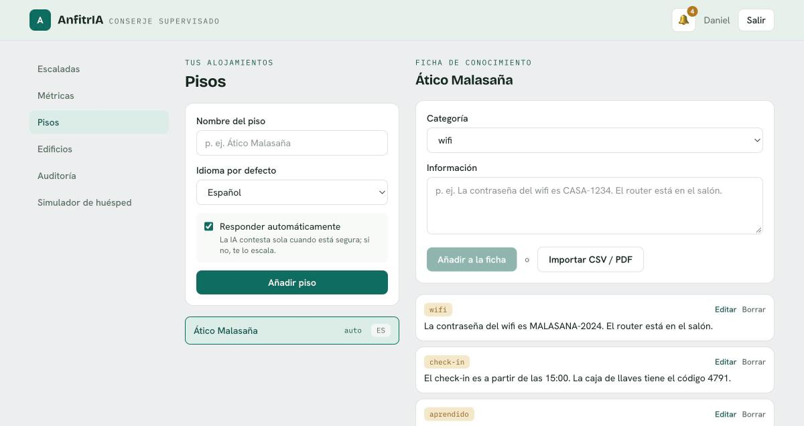

Y una auditoría de todo: qué decidió la IA y qué hizo el anfitrión, con la hora.

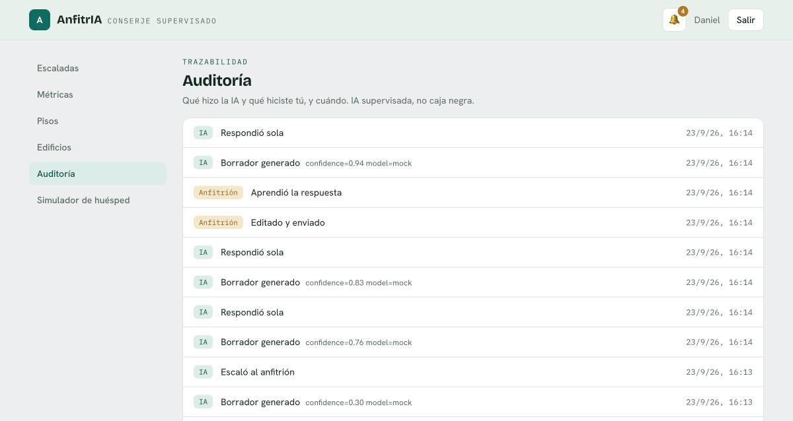

| Avisos de escalada | Editar / borrar conocimiento |
|:---:|:---:|
| 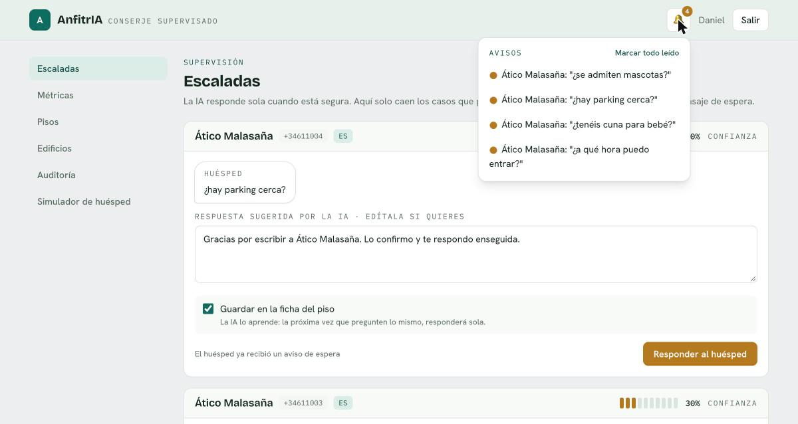 | 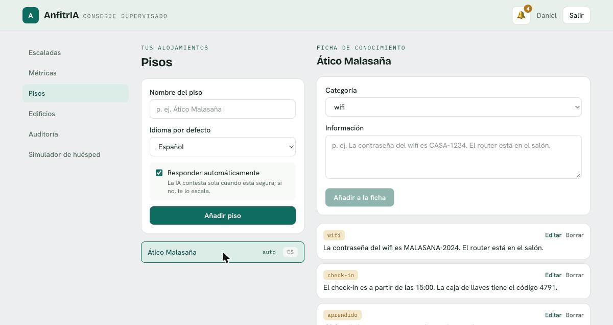 |

| Acceso | Pisos y conocimiento |
|:---:|:---:|
| 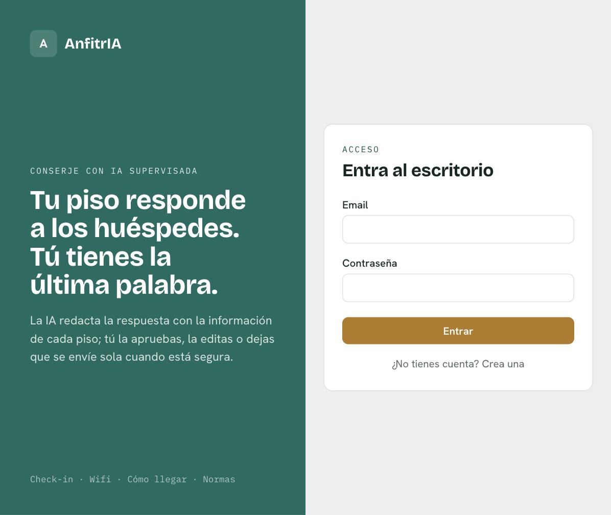 | 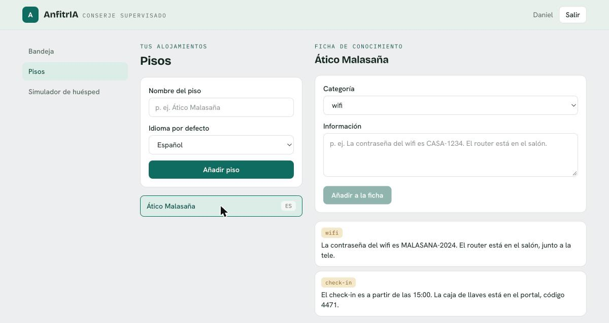 |

## La API

- `POST /auth/register` · `POST /auth/login` · `GET /auth/me`
- `POST /properties` · `GET /properties` · `POST/GET /properties/{id}/knowledge`
- `POST /properties/{id}/knowledge/import` — sube un CSV o PDF y crea la ficha de golpe
- `POST /channels/sim/inbound` — simula un mensaje de huésped: la IA responde sola si tiene confianza; si no, avisa y escala
- `GET /conversations` · `GET /conversations/{id}/messages`
- `GET /inbox` — escaladas pendientes · `POST /drafts/{id}/approve` — responder al huésped

Está todo navegable en `http://localhost:8000/docs`.

## Qué lleva por dentro

- **Backend:** Python 3.12, FastAPI (async), SQLAlchemy 2 async, Alembic, Redis + ARQ, uv
- **Base de datos:** PostgreSQL 16 + pgvector (para el RAG)
- **IA:** adaptador `mock` (sin clave) o `anthropic` (Claude de verdad)
- **Embeddings:** `mock` (bolsa de palabras) o `local` (un modelo multilingüe que corre en local, sin clave)
- **WhatsApp:** adaptador `sim` (simulado) o `whatsapp_cloud` (Meta Cloud API)
- **Frontend:** React + TypeScript + Vite + Tailwind
- **Infra:** Docker Compose (db, redis, api, worker, web)

Casi todo va detrás de adaptadores: la demo arranca con las piezas gratis
(`mock`/`sim`) y se pasa a las de verdad (Claude, WhatsApp) sin tocar la lógica.

## Cómo arrancarlo

```bash
cp .env.example .env     # opcional: los valores por defecto ya sirven
docker compose up --build
```

- API: http://localhost:8000 · Docs: http://localhost:8000/docs
- Web: http://localhost:5173

Para probar sin crear todo a mano, hay datos de ejemplo (un anfitrión y tres
pisos con su ficha):

```bash
docker compose exec api uv run python -m scripts.seed
```

Entras con `demo@anfitria.com` / `Demo12345!`. Con `EMBED_PROVIDER=local` (el de
por defecto), la primera consulta descarga el modelo de embeddings una vez.

Solo el backend, sin Docker:

```bash
cd backend
uv sync
uv run uvicorn app.main:app --reload   # necesita Postgres/Redis
uv run pytest                          # tests
uv run ruff check .                    # lint
```

## Cómo está organizado

```
anfitria/
├── backend/            # FastAPI + worker ARQ
│   ├── app/            # rutas, modelos, servicios y adaptadores
│   └── eval/           # el sistema de evaluación del RAG
├── frontend/           # React + TypeScript (Vite)
├── docs/               # spec, cómo funciona el RAG y el case study
└── docker-compose.yml  # db (pgvector), redis, api, worker, web
```

## Cómo lo fui construyendo

Lo hice por fases, de lo más simple a lo más completo:

1. El andamiaje: repo, Docker, `/health`, el shell de React, Postgres y Redis.
2. El núcleo: login, pisos, su ficha, conversaciones, el canal simulado, la IA
   `mock` y el flujo de aprobación con auditoría.
3. El RAG: pgvector + embeddings para que las respuestas se anclen al piso.
4. Claude de verdad (el adaptador `anthropic`), activable con una clave.
5. WhatsApp real (Meta Cloud API, con webhook y firma HMAC). Ver [`docs/WHATSAPP.md`](docs/WHATSAPP.md).
6. Métricas y pulido del panel.
7. Que la IA aprenda de las escaladas, y conocimiento compartido por edificio.

## Lo que faltaría para producción

Es una demo sólida, pero para usarla con huéspedes reales todavía habría trabajo,
sobre todo operativo:

- El alta real de WhatsApp Business tiene su miga (verificación de Meta,
  plantillas aprobadas, la ventana de 24 h, opt-in del huésped).
- Afinar la calidad: ampliar el set de evaluación, calibrar la confianza y
  vigilar regresiones.
- Gestionar el conocimiento que se va aprendiendo (detectar lo que queda
  desactualizado o se contradice).
- Lo "aburrido" pero necesario: monitorización, mensajes que no son texto
  (foto/audio) y privacidad de los datos del huésped (GDPR).

Aun así, lo que ya está montado va en serio: migraciones con Alembic, el webhook
con firma HMAC e idempotencia, sesión en cookie httpOnly con refresh y
revocación, rate limiting, el prompt de Claude endurecido contra inyección, y CI
en GitHub Actions corriendo tests y lint en cada push.

## Hecho por

Daniel López — [@daaniidam](https://github.com/daaniidam).
